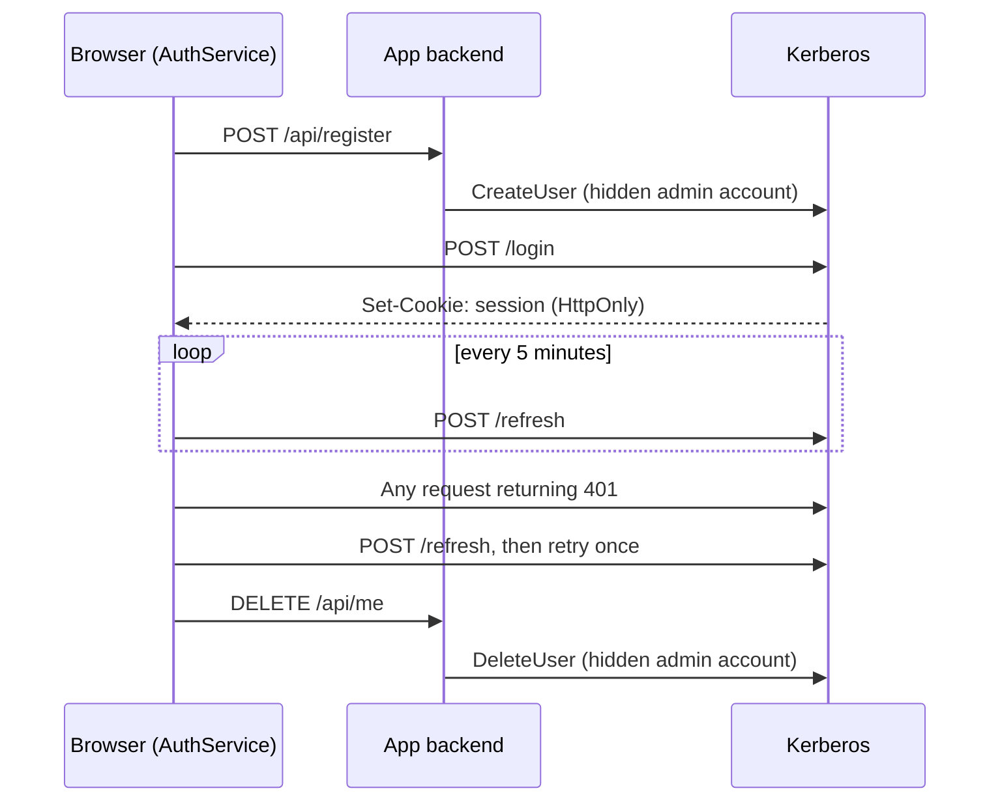

# Angular Bootstrap

[](https://github.com/maansaake/angular-bootstrap/actions/workflows/main.yaml)
[](https://github.com/maansaake/angular-bootstrap/actions/workflows/code-scanning.yaml)

A small, production-minded Angular 22 starter: register, log in, log out and manage a profile,
backed by [Kerberos](https://github.com/trebent/kerberos) authentication, Angular Material 3 and
OpenAPI-generated clients.

**[Try the live demo →](https://maansaake.github.io/angular-bootstrap/)**

## Quick start

```bash
git clone https://github.com/maansaake/angular-bootstrap.git my-app
cd my-app
make install
make serve
```

Open `http://localhost:4200`. No backend needed: an in-browser mock serves the API, the same one
the live demo uses.

## What's inside

- **Angular 22**: standalone components, signals, Signal Forms, zoneless change detection,
  lazy-loaded routes, strict TypeScript and strict templates.
- **Angular Material 3**: a single theme in `src/styles.scss`, built from `--mat-sys-*` tokens,
  with a System/Light/Dark switch.
- **Kerberos auth**: HttpOnly cookie sessions, automatic refresh, a 401 retry, route guards
  and organisation scoping.
- **OpenAPI clients**: typed Angular services generated from `openapi/` with `make codegen`.
- **Accessibility**: a skip link, focus management on navigation, and axe-core checks in every
  page spec. Targets WCAG 2.2 AA.
- **Tooling**: ESLint (including template accessibility rules), Prettier, Vitest with Material
  component harnesses, and GitHub Actions CI that deploys to GitHub Pages.

## How authentication works



- **Registration and account deletion** go through the app backend (`openapi/backend.yaml`).
  Kerberos requires an admin account for both, and that account must never reach the browser.
- **Everything else** goes straight to Kerberos (`openapi/auth_basic.yaml`) through the generated
  `UsersService`.
- **`AuthService`** (`src/app/services/auth.service.ts`) is the only place that knows about
  sessions. It exposes signals (`user`, `username`, `loggedIn`, `lastRefreshedAt`) and returns
  typed results (`{ ok: true } | { ok: false, reason }`) so pages can show accurate errors.
- **`authRefreshInterceptor`** catches a 401, refreshes the session once and retries.
- **`authGuard` / `guestGuard`** (`src/app/guards/`) protect `/profile`, keep signed-in users off
  `/login` and `/register`, and send users back to where they were going after logging in.

## Make it yours

1. **Rename** the project in `package.json`, `angular.json` (and the `dist/` path in
   `.github/workflows/deploy.yaml`), `src/index.html` and the header and footer.
2. **Retheme** by changing the palettes in `src/styles.scss`. Components only use system tokens,
   so nothing else needs to change.
3. **Connect a real backend**:
   - Delete `provideMockBackend()` from `src/app/app.config.ts` and remove `src/app/mocks/`.
   - Set `krbBaseUrl`, `backendBaseUrl` and `orgID` in `src/environments/`.
   - Implement `openapi/backend.yaml` (register and delete-me) in your backend.
4. **Change an API** by editing the spec in `openapi/`, then run `make codegen` and commit the
   output. Never hand-edit `src/app/services/auth-basic/` or `src/app/services/backend/`.

## Commands

| Command             | What it does                                      |
| ------------------- | ------------------------------------------------- |
| `make install`      | Install dependencies (`npm ci`)                   |
| `make serve`        | Start the dev server on `http://localhost:4200`   |
| `make check`        | Run everything CI runs: format, lint, build, test |
| `make format`       | Format the code with Prettier                     |
| `make format/check` | Check formatting without changing files           |
| `make lint`         | Lint and auto-fix with ESLint                     |
| `make lint/ci`      | Lint without fixing                               |
| `make build/prod`   | Production build into `dist/angular-bootstrap/`   |
| `make build/dev`    | Development build                                 |
| `make test`         | Run the unit tests once                           |
| `make codegen`      | Regenerate the API clients from `openapi/`        |

## Project layout

```text
src/app/
  app.config.ts        providers: router, HTTP, API clients, mock backend
  app.routes.ts        lazy routes and guards
  guards/              authGuard, guestGuard
  interceptors/        401 refresh-and-retry
  mocks/               demo-only in-browser backend (delete for real use)
  services/            AuthService, ThemeService and the generated clients
  shared/              validation rules, notifier and form helpers
  header/ footer/      app shell
  landing/ login/ register/ profile/
src/testing/           test helpers: AuthService stub, axe-core check
openapi/               API specs the clients are generated from
```

## CI and deployment

- **Pull requests and `main`**: format check, lint, build (including a check that the generated
  clients are up to date) and tests.
- **Deploy**: every push to `main` runs lint and tests, builds for production and publishes to
  GitHub Pages, with a `404.html` fallback so deep links work.

Coding conventions for humans and AI agents are in [`AGENTS.md`](AGENTS.md).
